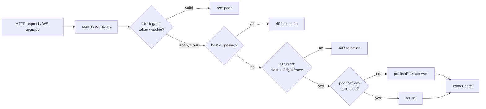

# dsh-bypass-web-token

[](https://www.npmjs.com/package/dsh-bypass-web-token)
[](./LICENSE)
[](https://nodejs.org)
[](https://www.npmjs.com/package/@deepseek-ai/dsh)

> A Cordis plugin that admits unauthenticated **loopback** traffic to a local `dsh` instance as an anonymous owner peer — without forking dsh, patching packages, or weakening the Host/Origin fence.

`dsh web` normally prints `http://127.0.0.1:<port>/?token=…`, and every local client — a browser you drive by hand, a headless automation script, a health probe — has to carry that token. This plugin replaces the admission gate on the live `connection` service instance so that requests arriving over loopback are let through as a single shared owner peer. Everything is scoped to the running process: no package is modified, no class is monkey-patched globally, and disposal restores the stock behaviour exactly.

> [!WARNING]
> The anonymous peer has the `owner` principal. Anything that can reach the loopback port — every local process, every browser tab on this machine — gains full read/write access to every session and RPC. Use it on a **trusted, single-user machine or a disposable test environment only**. Never bind a non-loopback listener: the plugin refuses to activate in that case.

---

## What it does

| Profile | `trustLoopback` | `GET /api/__probe__` | `GET /api/remote.mux` (WebSocket upgrade) |
| --- | --- | --- | --- |
| `anon-off` | `false` | **401** | **401** |
| `anon` | `true` | **404** (admitted — the probe route simply does not exist) | **101** (handshake completed) |

```text
=== summary ===
  anon-off probe=401  upgrade=401
  anon     probe=404  upgrade=101
```

Both transports are covered because the `/api` HTTP router and the WebSocket upgrade path dispatch through the same `connection.admit(...)` method.

## How it works



1. **Patch the instance, not the class.** A plugin installed into a dsh profile can resolve a *different* module instance than the one dsh booted, so prototype patches fail silently. The plugin takes the service from `ctx.get('connection')` and defines an own `admit` property that shadows the prototype method.
2. **The stock gate always runs first.** A request with a real browser/API credential is returned untouched, so authenticated traffic keeps its own peer.
3. **The Host/Origin fence is not optional.** Before minting a peer the wrapper calls the original `isTrusted(request)`. Unrelated origins and forged `Host` headers still get `403` — enabling anonymous loopback access does not disable CSRF / DNS-rebinding protection.
4. **One shared `interactions: 'answer'` peer.** `publishPeer('answer')` registers the peer in the service's `peers` map. `admitConnection` looks peers up by id to take socket ownership, so an `answer` peer is required; a browser peer would be rejected by `gateway/interactions-forbidden`.
5. **Peer lifecycle mirrors the socket.** When a WebSocket closes, dsh deletes the peer record. The wrapper notices the missing record on the next request and publishes a fresh peer instead of reusing a dead id — otherwise the second upgrade would fall back to `401`.
6. **Reversible and idempotent.** The exact original function reference is kept (no `bind` copy). Disposal writes it back, or deletes the own property when the method was inherited. Repeated installs share one patch through a `Symbol.for(...)` marker plus a reference count, so HMR reloads and duplicate `apply` calls cannot wrap the wrapper.

## Requirements

- Node.js **>= 20**
- `dsh` **0.2.1-rc.2** (Cordis **4.0.5**)
- The web listener must bind a loopback address: `localhost`, `127.0.0.0/8`, `::1`, or an IPv4-mapped loopback literal. Wildcards (`0.0.0.0`, `::`) and LAN addresses are refused.

## Install

### From npm

```bash
dsh plugin --profile web add dsh-bypass-web-token
```

Then enable it in the profile's `cordis.patch.yml`:

```yaml
- insert:
    - id: bypass-web-token
      name: dsh-bypass-web-token
      inject: ['connection', 'webServer']
      config:
        trustLoopback: true
```

Restart `dsh web`. The listener keeps printing its usual token URL; requests that arrive without one are now admitted as the anonymous owner peer.

To turn the behaviour off again, set `trustLoopback: false` (or remove the entry). The plugin then never installs anything and dsh behaves exactly as stock.

### From source

```bash
pnpm install
pnpm build
pnpm setup     # creates an isolated ./.dsh-home, never touches ~/.dsh
pnpm verify    # boots dsh twice and asserts the status codes above
```

`pnpm setup` copies `~/.dsh/profiles/web` into `./.dsh-home/profiles/anon`, links this repository into that profile, appends a `trustLoopback: true` entry, then clones the result as `anon-off` with the flag set to `false` for a control group. `pnpm verify` starts both profiles on port `18085`, sends token-less requests to `/api/__probe__` and `/api/remote.mux`, records the real status codes, and cleans the processes up with `SIGTERM`.

## Configuration

| Option | Type | Default | Description |
| --- | --- | --- | --- |
| `trustLoopback` | `boolean` | `false` | Admit unauthenticated loopback requests as an anonymous owner peer. When `false` the plugin installs nothing. |

`trustLoopback: true` is only honoured when the web listener itself is loopback. On any other address activation is skipped and dsh keeps serving with its stock token authentication.

## Failure modes

Activation never throws: every failed preflight check logs one line and leaves the plugin inactive, so the loader never records a failed entry and dsh keeps running.

| Situation | Log stage | Result |
| --- | --- | --- |
| `trustLoopback: false` | — | Silent, nothing installed |
| `ctx.get('webServer')` throws | `ctx.get('webServer')` | Plugin inactive |
| `webServer` service missing | `webServer` | Plugin inactive |
| `webServer.host` missing / not a string | `webServer.host` | Plugin inactive |
| Listener is not loopback | `webServer.host` | Plugin inactive, stock auth kept |
| `ctx.get('connection')` throws / missing | `connection` | Plugin inactive |
| `connection.admit` missing / not a function | `connection.admit` | Plugin inactive |
| `connection.isTrusted` missing | `connection.isTrusted` | Plugin inactive |
| `connection.publishPeer` missing | `connection.publishPeer` | Plugin inactive |
| `connection.peers` is not a `Map` | `connection.peers` | Plugin inactive |
| `ctx.effect` missing / throws | `ctx.effect` | Plugin inactive, partial patch rolled back |
| Instance frozen / `admit` read-only | `install` | Rolled back, plugin inactive |

All skip lines end with `(plugin inactive; dsh keeps stock auth)` and share the prefix `[dsh-bypass-web-token]`. The success line is printed only when the patch really landed (`installed === true`), so a refused install can never produce a contradictory "skip + success" pair.

At request time the wrapper is also non-throwing. A failing original `admit`, `isTrusted`, `publishPeer`, `peers.get`, or a malformed peer record degrades to `{ rejection: 401 }` — never a `500` — and each distinct error signature is logged once:

```text
[dsh-bypass-web-token] request path degraded: <stage> — <message> (returning 401)
```

Logging itself is best-effort: `console` calls are wrapped in `try/catch`, so a hostile or broken log sink cannot break `apply` or the request path.

## Security model

- **Trust boundary:** loopback interface + `Host`/`Origin` fence (`isTrusted`). Nothing else.
- **Granted principal:** `{ kind: 'owner' }` — equivalent to the local user. Any local process that can open a connection to the port gets the same power as the person who started dsh.
- **Not granted:** remote network access. Non-loopback listeners refuse activation; wildcard binds (`0.0.0.0`, `::`) are explicitly rejected by the loopback predicate.
- **Still protected:** cross-origin browser requests and DNS-rebinding attempts fail the `isTrusted` check and receive `403`.
- **Not covered:** TLS termination, reverse proxies, port forwarding, container-to-host mappings. If any of those put this port on a shared surface, the security model no longer holds.

## Compatibility and upgrade risk

The plugin depends on four internal members of `HostConnectionService`: `admit`, `isTrusted`, `publishPeer(interactions)`, and `peers`. They are present in `0.2.1-rc.2`, but they are not part of a stability contract.

- A renamed, removed, or non-function member is detected by the preflight probe: the plugin logs which member failed and stays inert.
- A change in `admit`'s signature or calling convention **cannot** be detected at install time (JavaScript carries no runtime types). The first request then throws inside the wrapper and is degraded to `401`; authentication is never opened by accident, but an upgrade may need manual review if anonymous access silently stops working.
- `inject` in Cordis 4.0.5 only supports a flat required-service list, so `webServer` is declared as required. If that whole service disappears, the fiber never activates and no skip line is printed — that is dependency injection, not a plugin bug.

## Development

```bash
pnpm typecheck   # src + tests
pnpm test        # vitest, 78 tests
pnpm build       # tsc -> dist
pnpm setup       # rebuild the isolated profiles
pnpm verify      # end-to-end status-code assertions
```

```text
package.json                 package metadata, ESM entry, dist-only publish
src/index.ts                 name / inject / Config / apply
src/admit.ts                 installAnonymousAdmitResult(conn) -> { dispose, installed, stage? }
                             installAnonymousAdmit(conn) -> dispose (compatibility wrapper)
src/guard.ts                 strict loopback predicate
tests/guard.spec.ts          loopback classification matrix
tests/admit.spec.ts          admission, idempotency, disposal, apply guards, failure isolation
scripts/setup-profile.mjs    build the anon / anon-off profile pair under .dsh-home
scripts/verify.mjs           boot both profiles, assert HTTP and WS status codes
```

`dist/`, `node_modules/`, and `.dsh-home/` are git-ignored.

## Limitations

- This is a **local development convenience**, not a production authentication scheme.
- Verification covers the transport layer: HTTP admission, WebSocket upgrade, disposal, and the failure matrix. It does not exercise RPC-level session behaviour, concurrency, TLS, or reverse proxies.
- The anonymous peer is shared by all admitted requests, so per-client identity and per-client isolation do not exist by design.

## License

[MIT](./LICENSE) © 2026 Casper-Mars

---

## 中文简介

`dsh-bypass-web-token` 是一个 Cordis 插件：在不修改官方包、不 fork、不用 patch-package 的前提下，运行时替换 `dsh` 实例上的 `connection.admit`，让**仅限 loopback** 的无 token 请求被接纳为一个匿名 owner peer。

- 默认关闭（`trustLoopback: false`），开启后也只在本机回环监听时生效；非 loopback 监听会拒绝激活，dsh 继续使用官方 token 鉴权。
- 保留 Host/Origin 围栏，跨源与 DNS rebinding 请求仍返回 403。
- 激活失败、运行期异常、日志 sink 异常都不会让 dsh 崩溃，一律 fail-closed 退化为 401。
- 匿名 peer 是 `owner` 权限，等同于本机全权，只应在可信单机或一次性测试环境中使用。
