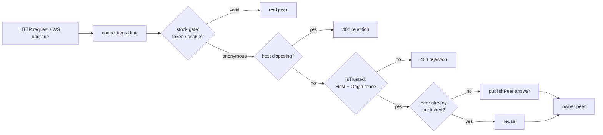

# dsh-bypass-web-token

[](https://www.npmjs.com/package/dsh-bypass-web-token)
[](./LICENSE)
[](https://nodejs.org)
[](https://www.npmjs.com/package/@deepseek-ai/dsh)

> A zero-configuration Cordis plugin that admits unauthenticated `/api` traffic to a `dsh` instance as an anonymous owner peer — install it and it is on, remove it and dsh is stock again. No options, no listener-address admission rule, no forked packages, and no weakening of the Host/Origin fence.

`dsh web` normally prints `http://127.0.0.1:<port>/?token=…`, and every client — a browser you drive by hand, a headless automation script, a health probe — has to carry that token. This plugin replaces the admission gate on the live `connection` service instance so that requests to the `/api` surface are let through as a single shared owner peer. Everything is scoped to the running process: no package is modified, no class is monkey-patched globally, and disposal restores the stock behaviour exactly.

> [!WARNING]
> The anonymous peer has the `owner` principal. There is **no listener-address restriction**: whatever address the web server binds, anything that can reach that port — every local process, every browser tab on the machine, and every host on the LAN when you bind a LAN address — gains full read/write access to every session and RPC. Use it on a **trusted, single-user machine or a disposable test environment only**, and never map the port to the public internet.

---

## What it does

| Profile | Listener | Plugin | `GET /api/__probe__` | `GET /api/remote.mux` (WebSocket upgrade) |
| --- | --- | --- | --- | --- |
| `anon-off` | `127.0.0.1` | absent | **401** | **401** |
| `anon` | `127.0.0.1` | installed | **404** (admitted — the probe route simply does not exist) | **101** (handshake completed) |
| `anon-off` | LAN IP | absent | **401** | **401** |
| `anon` | LAN IP | installed | **404** (admitted) | **101** (handshake completed) |

```text
=== summary ===
  anon-off  127.0.0.1       :18085  probe=401  upgrade=401
  anon      127.0.0.1       :18085  probe=404  upgrade=101
  anon-off  192.168.1.92    :18086  probe=401  upgrade=401
  anon      192.168.1.92    :18086  probe=404  upgrade=101
```

Both transports are covered because the `/api` HTTP router and the WebSocket upgrade path dispatch through the same `connection.admit(...)` method. Installing the plugin is the switch; the control profile simply does not install it. On a non-loopback listener the success line is preceded by a `WARNING` line naming the bind address.

### What is actually admitted

Admission is limited to traffic that reaches `connection.admit`: the `/api/*` HTTP routes and the `/api/remote.mux` WebSocket upgrade. That is the surface automation clients use.

- `GET /api/<anything>` without a token → admitted (`404` when the route does not exist, i.e. the request was no longer rejected by the token gate).
- `GET /api/remote.mux` upgrade without a token → `101`.
- `GET /`, `GET /index.html`, and the rest of the static web UI without a token → **still 401**. The page shell has its own gate, which this plugin does not touch. A browser UI session still needs the printed `?token=…` URL; the plugin does not make the UI tokenless.

## How it works



1. **Patch the instance, not the class.** A plugin installed into a dsh profile can resolve a *different* module instance than the one dsh booted, so prototype patches fail silently. The plugin takes the service from `ctx.get('connection')` and defines an own `admit` property that shadows the prototype method.
2. **The stock gate always runs first.** A request with a real browser/API credential is returned untouched, so authenticated traffic keeps its own peer.
3. **The Host/Origin fence is not optional.** Before minting a peer the wrapper calls the original `isTrusted(request)`. Unrelated origins and forged `Host` headers still get `403` — enabling anonymous access does not disable CSRF / DNS-rebinding protection.
4. **One shared `interactions: 'answer'` peer.** `publishPeer('answer')` registers the peer in the service's `peers` map. `admitConnection` looks peers up by id to take socket ownership, so an `answer` peer is required; a browser peer would be rejected by `gateway/interactions-forbidden`.
5. **Peer lifecycle mirrors the socket.** When a WebSocket closes, dsh deletes the peer record. The wrapper notices the missing record on the next request and publishes a fresh peer instead of reusing a dead id — otherwise the second upgrade would fall back to `401`.
6. **Reversible and idempotent.** The exact original function reference is kept (no `bind` copy). Disposal writes it back, or deletes the own property when the method was inherited. Repeated installs share one patch through a `Symbol.for(...)` marker plus a reference count, so HMR reloads and duplicate `apply` calls cannot wrap the wrapper.
7. **The bind address is only a log detail.** `webServer` is looked up optionally and `webServer.host` is read for wording (loopback → info, otherwise → warning). A missing service, a throwing lookup, or a missing/non-string/throwing `host` cannot block activation; the line then says `unknown`.

## Requirements

- Node.js **>= 20**
- `dsh` **0.2.1-rc.2** (Cordis **4.0.5**)
- The plugin itself works with any bind address. To listen beyond loopback, `dsh` needs a **concrete IPv4 or IPv6 address** — `--host 192.168.1.92` — because dsh itself rejects wildcard binds at both the CLI and schema layer: `error: --host 0.0.0.0 is an unspecified (wildcard) address, which is not supported: binding every interface would expose remote code execution to the network; bind one concrete IPv4 or IPv6 address instead`. The plugin makes no address decision, but wildcard binds remain impossible because dsh refuses them before the plugin loads.

## Install

### From npm

```bash
dsh plugin --profile web add dsh-bypass-web-token
```

Then make sure the profile's `cordis.patch.yml` contains the plugin entry — there is no `config` block:

```yaml
- insert:
    - id: bypass-web-token
      name: dsh-bypass-web-token
      inject: ['connection']
```

Restart `dsh web`. The listener keeps printing its usual token URL; requests that arrive without one are now admitted as the anonymous owner peer.

To turn the behaviour off again, remove the entry (or uninstall the plugin) and restart. dsh then behaves exactly as stock.

### From source

```bash
pnpm install
pnpm build
pnpm setup     # creates an isolated ./.dsh-home, never touches ~/.dsh
pnpm verify    # boots dsh four times and asserts the status codes above
```

`pnpm setup` copies `~/.dsh/profiles/web` into `./.dsh-home/profiles/anon`, links this repository into that profile, and appends the config-free plugin entry. A second copy of the stock template is created as `anon-off` **without** the plugin, as the control group. `pnpm verify` boots each profile on loopback (`127.0.0.1:18085`) and, with `--host <first non-internal IPv4>`, on the LAN (`:18086`) — four boots in total. It sends token-less requests to `/api/__probe__` and `/api/remote.mux`, records the real status codes, and cleans the processes up with `SIGTERM`.

Automation clients on the LAN can then call `http://192.168.1.92:8081/api/...` without a token, and a WebSocket client can open `ws://192.168.1.92:8081/api/remote.mux` without one. The browser UI at `http://192.168.1.92:8081/` still returns `401` for the page shell — use the printed `?token=…` URL if you also want the UI.

## Activation logs

On a loopback listener activation logs exactly one line:

```text
[dsh-bypass-web-token] loopback listener 127.0.0.1: anonymous requests are admitted as an owner peer
```

On a non-loopback listener (or when the address cannot be read) it logs a warning first, then the info line:

```text
[dsh-bypass-web-token] WARNING: anonymous admission is enabled on non-loopback listener 192.168.1.92 — every host that can reach this port gets owner access
[dsh-bypass-web-token] non-loopback listener 192.168.1.92: anonymous requests are admitted as an owner peer
```

When `webServer` is unavailable or `host` is missing/non-string/throwing, both lines say `unknown`; activation still succeeds.

## Failure modes

Activation never throws: every failed preflight check logs one line and leaves the plugin inactive, so the loader never records a failed entry and dsh keeps running.

| Situation | Log stage | Result |
| --- | --- | --- |
| `ctx.get('connection')` throws / service missing | `connection` | Plugin inactive |
| `connection.admit` missing / not a function | `connection.admit` | Plugin inactive |
| `connection.isTrusted` missing | `connection.isTrusted` | Plugin inactive |
| `connection.publishPeer` missing | `connection.publishPeer` | Plugin inactive |
| `connection.peers` is not a `Map` | `connection.peers` | Plugin inactive |
| `ctx.effect` missing / throws | `ctx.effect` | Plugin inactive, partial patch rolled back |
| Instance frozen / `admit` read-only | `install` | Rolled back, plugin inactive |
| `webServer` missing, lookup throws, `host` unreadable | — | **Still active**, log says `unknown` |

All skip lines end with `(plugin inactive; dsh keeps stock auth)` and share the prefix `[dsh-bypass-web-token]`. The success line is printed only when the patch really landed (`installed === true`), so a refused install can never produce a contradictory "skip + success" pair.

At request time the wrapper is also non-throwing. A failing original `admit`, `isTrusted`, `publishPeer`, `peers.get`, or a malformed peer record degrades to `{ rejection: 401 }` — never a `500` — and each distinct error signature is logged once:

```text
[dsh-bypass-web-token] request path degraded: <stage> — <message> (returning 401)
```

Logging itself is best-effort: every `console` call (`error`, `info`, `warn`) is wrapped in `try/catch`, so a hostile or broken log sink cannot break `apply` or the request path.

## Security model

- **Trust boundary:** there is none beyond reaching the port. Installing the plugin grants owner access on every bind address; the only gate left is the `Host`/`Origin` fence, which blocks cross-origin browser requests and DNS rebinding, not direct clients.
- **Granted principal:** `{ kind: 'owner' }` — equivalent to the local user. On a LAN bind this means every machine that can route to that address gets the same power as the person who started dsh.
- **Still protected:** cross-origin browser requests and DNS-rebinding attempts fail the `isTrusted` check and receive `403`. The plugin never disables that fence. The page shell at `/` keeps its own token gate.
- **Exposure is bounded by the bind address, not by the plugin:** `dsh` refuses `0.0.0.0` / `::`, so exposure follows the concrete address you choose.
- **Never do this:** map the port to the public internet, expose it through a reverse proxy, or bind a LAN address on an untrusted network (café/hotel/office guest Wi-Fi).
- **Not covered:** TLS termination, reverse proxies, port forwarding, container-to-host mappings. If any of those put this port on a shared surface, the security model no longer holds.

## Compatibility and upgrade risk

The plugin depends on four internal members of `HostConnectionService`: `admit`, `isTrusted`, `publishPeer(interactions)`, and `peers`. They are present in `0.2.1-rc.2`, but they are not part of a stability contract.

- A renamed, removed, or non-function member is detected by the preflight probe: the plugin logs which member failed and stays inert.
- A change in `admit`'s signature or calling convention **cannot** be detected at install time (JavaScript carries no runtime types). The first request then throws inside the wrapper and is degraded to `401`; authentication is never opened by accident, but an upgrade may need manual review if anonymous access silently stops working.
- `inject` only declares `connection`. `webServer` is read with `ctx.get('webServer')` purely for log wording, so a dsh build without that service still activates, logging `unknown`.

## Development

```bash
pnpm typecheck   # src + tests
pnpm test        # vitest, 81 tests
pnpm build       # tsc -> dist
pnpm setup       # rebuild the isolated profiles (anon / anon-off)
pnpm verify      # end-to-end status-code assertions
```

```text
package.json                 package metadata, ESM entry, dist-only publish
src/index.ts                 name / inject / empty Config / apply
src/admit.ts                 installAnonymousAdmitResult(conn) -> { dispose, installed, stage? }
                             installAnonymousAdmit(conn) -> dispose (compatibility wrapper)
src/guard.ts                 strict loopback predicate (log wording only)
tests/guard.spec.ts          loopback classification matrix
tests/admit.spec.ts          admission, idempotency, disposal, apply guards, failure isolation
scripts/setup-profile.mjs    build the anon / anon-off profiles under .dsh-home
scripts/verify.mjs           boot both profiles on loopback and LAN, assert HTTP and WS status codes
```

`dist/`, `node_modules/`, and `.dsh-home/` are git-ignored.

## Limitations

- This is a **local development convenience**, not a production authentication scheme.
- Verification covers the transport layer: HTTP admission, WebSocket upgrade, disposal, and the failure matrix. It does not exercise RPC-level session behaviour, concurrency, TLS, or reverse proxies.
- The anonymous peer is shared by all admitted requests, so per-client identity and per-client isolation do not exist by design.
- The static web UI is out of scope: it keeps its own token gate.

## License

[MIT](./LICENSE) © 2026 Casper-Mars

---

## 中文简介

`dsh-bypass-web-token` 是一个 Cordis 插件：在不修改官方包、不 fork、不用 patch-package 的前提下，运行时替换 `dsh` 实例上的 `connection.admit`，让无 token 请求被接纳为一个匿名 owner peer。

- **零配置：装上插件即生效，卸载插件即恢复**。没有任何配置项，`cordis.patch.yml` 里只有 `id` / `name` / `inject`。
- 安装后不再对监听地址做任何准入判断，Loopback、LAN IP 一视同仁；监听地址只影响日志措辞：回环地址打一条 info；非回环地址先打一条 WARNING（提示「所有能访问该端口的主机都获得 owner 权限」）再打一条 info。
- 准入范围仅 `/api/*` HTTP 与 `/api/remote.mux` WebSocket upgrade；访问 `/`、`/index.html` 等页面外壳仍然需要 `?token=…`，浏览器 UI 并不会因此免 token。
- `0.0.0.0` / `::` 由 dsh 自身在 CLI 与 schema 层拒绝，请显式绑定具体 IPv4/IPv6 地址（如 `192.168.1.92`）。
- 保留 Host/Origin 围栏，跨源与 DNS rebinding 请求仍返回 403。
- 激活失败、运行期异常、日志 sink 异常都不会让 dsh 崩溃，一律 fail-closed 退化为 401。
- 匿名 peer 是 `owner` 权限，等同于本机全权；绑定 LAN 地址时等同于把 owner 权限交给能访问该端口的任何主机，只应在可信内网使用，绝不要暴露到公网。
