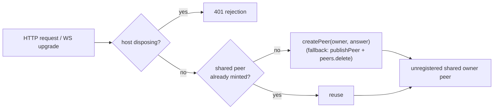

# dsh-local-admission

[](https://www.npmjs.com/package/dsh-local-admission)
[](./LICENSE)
[](https://nodejs.org)
[](https://www.npmjs.com/package/@deepseek-ai/dsh)

> A zero-configuration Cordis plugin that provides local admission to a `dsh` instance for development automation — web UI, `/api`, `/connect`, and WebSocket. Install it and local admission is active; remove it and dsh is stock again. No options, no additional bind-address rule, no forked packages. The stock `admit` is not called, and `Host`/`Origin` are not consulted.

`dsh web` normally prints `http://127.0.0.1:<port>/?token=…`, and every client — a browser you drive by hand, a headless automation script, a health probe — has to carry that token. This plugin overrides three gates on the live `connection` service instance — `admit` for `/api` and WebSocket, `authorizeIndex` for the UI shell, and `authorizeConnect` for the `/connect` launch-token exchange — so every client that reaches the port is admitted as a single shared owner peer. Everything is scoped to the running process: no package is modified, no class is monkey-patched globally, and disposal restores the stock behaviour exactly.

> [!WARNING]
> While the plugin is active, the only admission criterion is that a client can reach the port: no launch token, no cookie, no `Host` check, no `Origin` check, no `isTrusted`. Admitted clients are treated as the `owner` principal, and `GET /connect` returns an empty session cookie. Whatever address the web server binds, every client that can reach that port — every local process, **every web page running in any browser on the machine (cross-origin requests included)**, and every host on the LAN when you bind a LAN address — has full read/write access to every session and RPC. Use it only on an **operator-controlled, single-user machine or a disposable test environment**, and never map the port to the public internet or put it behind a reverse proxy.

---

## What it does

| Profile | Listener | Plugin | `GET /` | `GET /api/__probe__` | `GET /api/__probe__` + cross-origin `Origin` | `GET /connect?interactions=answer` | `GET /api/remote.mux` (WebSocket upgrade) |
| --- | --- | --- | --- | --- | --- | --- | --- |
| `anon-off` | `127.0.0.1` | absent | **401** | **401** | **403** | **401** | **401** |
| `anon` | `127.0.0.1` | installed | **200** | **404** (admitted) | **404** (admitted) | **302** + empty cookie | **101** |
| `anon-off` | LAN IP | absent | **401** | **401** | **403** | **401** | **401** |
| `anon` | LAN IP | installed | **200** | **404** (admitted) | **404** (admitted) | **302** + empty cookie | **101** |

```text
=== summary ===
  anon-off  127.0.0.1       :18085  index=401  probe=401  evil=403  connect=401  cookie=none  upgrade=401
  anon      127.0.0.1       :18085  index=200  probe=404  evil=404  connect=302  cookie=empty upgrade=101
  anon-off  192.168.1.92    :18086  index=401  probe=401  evil=403  connect=401  cookie=none  upgrade=401
  anon      192.168.1.92    :18086  index=200  probe=404  evil=404  connect=302  cookie=empty upgrade=101
```

All five transports are covered because the `/api` HTTP router, the `/connect` exchange, and the WebSocket upgrade path dispatch through the same `connection` instance. Installing the plugin is the switch; the control profile simply does not install it. On a non-loopback listener the success line is preceded by a `WARNING` line naming the bind address.

### What is actually admitted

The plugin overrides **three** gates: `connection.admit` (the `/api/*` HTTP routes and the `/api/remote.mux` WebSocket upgrade), `connection.authorizeIndex` (the web UI shell, which normally demands a `?token=` query or a signed browser cookie), and `connection.authorizeConnect` (the `/connect` launch-token exchange).

- `GET /api/<anything>` without a token → admitted (`404` when the route does not exist, i.e. the request was no longer rejected by the token gate).
- `GET /api/<anything>` with a cross-origin `Origin` and a forged `Host` → **also admitted**; no `Host`/`Origin` check is applied.
- `GET /api/remote.mux` upgrade without a token → `101`.
- `GET /` without a token or cookie → **200**, the UI loads and its API calls go through the same override. No cookie is minted, validated, or required.
- `GET /connect?interactions=answer` without a token → **302** to `./api/remote.mux` with `set-cookie: dsh-session=; Path=/; HttpOnly; SameSite=Lax`. The cookie is deliberately **empty**: nothing is signed and nothing is read back.

The stock cookie/token flow is replaced rather than forged: `authorizeIndex` is replaced with `() => true`, and `authorizeConnect` never reads the launch token.

## How it works



1. **Patch the instance, not the class.** A plugin installed into a dsh profile can resolve a *different* module instance than the one dsh booted, so prototype patches fail silently. The plugin takes the service from `ctx.get('connection')` and defines own properties that shadow the prototype methods.
2. **`admit` is replaced, not wrapped.** The stock `admit` is never called: no credential lookup, no `isTrusted`, no `Host`/`Origin` comparison, no 403 branch. A disposing host still answers `401`; everything else is admitted. This is a deliberate full local-trust model for an operator-controlled machine, not an authentication extension.
3. **One shared `interactions: 'answer'` peer that is deliberately NOT in `peers`.** `admit` mints it once through `connection.createPeer({ principal: { kind: 'owner' }, interactions: 'answer' })` — the same shape as the stock `browserPeer` — or, on a build without `createPeer`, through `publishPeer('answer')` followed by `peers.delete(id)`. Keeping it out of the registry is what makes multi-tab and reconnect work: `admitConnection` grants *exclusive* socket ownership (`record.ownsSocket = true`) only to registered peers, so a registered peer answers `409 Conflict` to every second `/api/remote.mux` upgrade until the first socket closes. An unregistered peer takes `admitConnection`'s early `release: () => Promise.resolve()` branch, exactly like `browserPeer`, and any number of tabs/clients can share it. `interactions: 'answer'` itself is required: a `none` peer is rejected with `gateway/interactions-forbidden` when the client opens its `$events` stream.
4. **Peer lifetime is the process, not the socket.** Sockets never own or dispose the shared peer, so closing a tab, reloading, or racing a reconnect cannot invalidate it. The plugin disposes it when it is uninstalled; if the `peers` registry cannot remove the fallback peer, admission degrades to `401` instead of silently serialising sockets.
5. **`authorizeConnect` no longer exchanges a launch token.** It keeps the official query parsing (`interactions` must be declared at most once, as `answer` or `none`; otherwise `400`), publishes the peer through the supplied `publish` callback (or `publishPeer` when dsh calls the instance method with two arguments), and answers `302` to `./api/remote.mux` with an empty `dsh-session` cookie. No secret is read, nothing is signed, and non-`GET` / non-`/connect` requests return `false` to the caller.
6. **`authorizeIndex` answers `true` for every request.** No token, no cookie, no redirect; `BrowserAuth.authenticate` is never consulted for the index route.
7. **Reversible and idempotent.** The exact original function references are kept (no `bind` copy). Disposal writes them back, or deletes the own property when the method was inherited. Repeated installs share one patch through a `Symbol.for(...)` marker plus a reference count, so HMR reloads and duplicate `apply` calls cannot wrap the wrapper. If any of the three writes fails, all three are rolled back.
8. **The bind address is only a log detail.** `webServer` is looked up optionally and `webServer.host` is read for wording (loopback → info, otherwise → warning). A missing service, a throwing lookup, or a missing/non-string/throwing `host` cannot block activation; the line then says `unknown`.

## Requirements

- Node.js **>= 20**
- `dsh` **0.2.1-rc.2** (Cordis **4.0.5**)
- The plugin itself works with any bind address. To listen beyond loopback, `dsh` needs a **concrete IPv4 or IPv6 address** — `--host 192.168.1.92` — because dsh itself rejects wildcard binds at both the CLI and schema layer: `error: --host 0.0.0.0 is an unspecified (wildcard) address, which is not supported: binding every interface would expose remote code execution to the network; bind one concrete IPv4 or IPv6 address instead`. The plugin makes no address decision, but wildcard binds remain impossible because dsh refuses them before the plugin loads.

## Install

### From npm

```bash
dsh plugin --profile web add dsh-local-admission
```

That is the whole installation. The package declares `dsh.bundle`, so `dsh plugin add` registers it in the profile's `dsh.profile.bundles` and the bundle layer inserts the plugin entry — **no `cordis.patch.yml` editing, no config block**. Restart `dsh web` and the UI, `/api/*`, and the WebSocket mux are all reachable without a token.

To turn the behaviour off again, `dsh plugin --profile web remove dsh-local-admission` and restart. dsh then behaves exactly as stock.

### From source

```bash
pnpm install
pnpm build
pnpm setup     # creates an isolated ./.dsh-home, never touches ~/.dsh
pnpm verify    # boots dsh four times and asserts the status codes above
```

`pnpm setup` copies `~/.dsh/profiles/web` into `./.dsh-home/profiles/anon` and installs this repository into that profile with `dsh plugin add` — the same one-command path end users take, which registers the bundle and applies its patch. A second copy of the stock template is created as `anon-off` **without** the plugin, as the control group. `pnpm verify` boots each profile on loopback (`127.0.0.1:18085`) and, with `--host <first non-internal IPv4>`, on the LAN (`:18086`) — four boots in total. It sends requests without credentials to `/api/__probe__` and `/api/remote.mux`, records the real status codes, and cleans the processes up with `SIGTERM`.

Automation clients on the LAN can then call `http://192.168.1.92:8081/api/...` without a token, a WebSocket client can open `ws://192.168.1.92:8081/api/remote.mux` without one, and a browser can open `http://192.168.1.92:8081/` directly — the UI loads without a token or cookie.

## Activation logs

On a loopback listener activation logs exactly one line:

```text
[dsh-local-admission] local admission is active on loopback listener 127.0.0.1 — clients are treated as the owner principal
```

On a non-loopback listener (or when the address cannot be read) it logs a warning first, then the info line:

```text
[dsh-local-admission] WARNING: local admission is active on non-loopback listener 192.168.1.92 — clients that can reach this port are treated as the owner principal
[dsh-local-admission] non-loopback listener 192.168.1.92 — local admission is active
```

When `webServer` is unavailable or `host` is missing/non-string/throwing, both lines say `unknown`; activation still succeeds.

## Failure modes

Activation never throws: every failed preflight check logs one line and leaves the plugin inactive, so the loader never records a failed entry and dsh keeps running.

| Situation | Log stage | Result |
| --- | --- | --- |
| `ctx.get('connection')` throws / service missing | `connection` | Plugin inactive |
| `connection.admit` missing / not a function | `connection.admit` | Plugin inactive |
| `connection.isTrusted` missing | — | **Still active**: the override never calls it |
| `connection.publishPeer` missing | `connection.publishPeer` | Plugin inactive |
| `connection.peers` is not a `Map` | `connection.peers` | Plugin inactive |
| `ctx.effect` missing / throws | `ctx.effect` | Plugin inactive, partial patch rolled back |
| Instance frozen / any of the three gates read-only | `install` | All three gates rolled back, plugin inactive |
| `webServer` missing, lookup throws, `host` unreadable | — | **Still active**, log says `unknown` |
| `connection.authorizeIndex` missing / not a function | — | **Still active**: `/api`, `/connect`, and WebSocket are admitted without a token, the UI shell keeps its token gate |
| `connection.authorizeConnect` missing / not a function | — | **Still active**: `/api`, WebSocket, and the UI are admitted without a token, `/connect` keeps its launch-token exchange |

All skip lines end with `(plugin inactive; dsh keeps stock auth)` and share the prefix `[dsh-local-admission]`. The success line is printed only when the patch really landed (`installed === true`), so a refused install can never produce a contradictory "skip + success" pair.

At request time the wrapper is also non-throwing. A failing `publishPeer`, `peers.get`, a throwing `disposed` getter, or a malformed peer record degrades to `{ rejection: 401 }` — never a `500` — and each distinct error signature is logged once. An internal failure inside `authorizeConnect` degrades to `401` the same way; the stock implementation is never called as a fallback.

```text
[dsh-local-admission] request path degraded: <stage> — <message> (returning 401)
```

Logging itself is best-effort: every `console` call (`error`, `info`, `warn`) is wrapped in `try/catch`, so a throwing or broken log sink cannot break `apply` or the request path.

## Security model

- **Trust boundary: reachability of the port.** There is no request-level admission check beyond reachability — no token, no cookie, no `Host` check, no `Origin` check, no `isTrusted`. Reaching the port is treated as authorization: installing the plugin grants owner access on every bind address.
- **Granted principal:** `{ kind: 'owner' }` — equivalent to the local user. On a LAN bind this means every machine that can route to that address gets the same power as the person who started dsh.
- **Cross-origin browser requests are admitted too.** A page on any origin can call this port and gets the same owner peer; `verify` asserts this explicitly (stock → `403`, plugin → `404` admitted). DNS-rebinding protection is not applied either.
- **`/connect` mints no credential.** It answers `302` with `dsh-session=` (empty value). Nothing is signed, so there is no secret to leak and no cookie to replay — the token exchange no longer applies.
- **Exposure is bounded by the bind address, not by the plugin:** `dsh` refuses `0.0.0.0` / `::`, so exposure follows the concrete address you choose.
- **Never do this:** map the port to the public internet, expose it through a reverse proxy, or bind a LAN address on an untrusted network (café/hotel/office guest Wi-Fi).
- **Not covered:** TLS termination, reverse proxies, port forwarding, container-to-host mappings. If any of those put this port on a shared surface, the security model no longer holds.

## Compatibility and upgrade risk

The plugin depends on two internal members of `HostConnectionService`: `admit` and `publishPeer(interactions)`, plus the `peers` map (used as the fallback when `createPeer` is absent). `createPeer(options)`, `authorizeIndex`, and `authorizeConnect` are used when present and degraded gracefully when not. `isTrusted` is no longer read at all. None of these are part of a stability contract.

- A renamed, removed, or non-function required member is detected by the preflight probe: the plugin logs which member failed and stays inert.
- A missing `authorizeIndex` or `authorizeConnect` only produces a warning; the remaining gates stay active.
- A change in `admit`'s signature or calling convention **cannot** be detected at install time (JavaScript carries no runtime types). The first request then degrades to `401`; authentication is never opened by accident, but an upgrade may need manual review if local admission silently stops working.
- `inject` only declares `connection`. `webServer` is read with `ctx.get('webServer')` purely for log wording, so a dsh build without that service still activates, logging `unknown`.

## Development

```bash
pnpm typecheck   # src + tests
pnpm test        # vitest, 90 tests
pnpm build       # tsc -> dist
pnpm setup       # rebuild the isolated profiles (anon / anon-off)
pnpm verify      # end-to-end status-code assertions
```

```text
package.json                 package metadata, ESM entry, dist-only publish
src/index.ts                 name / inject / empty Config / apply
src/admit.ts                 installAnonymousAdmitResult(conn) -> { dispose, installed, stage? }
                             installAnonymousAdmit(conn) -> dispose (compatibility wrapper)
src/guard.ts                 strict loopback predicate (log wording only)
tests/guard.spec.ts          loopback classification matrix
tests/admit.spec.ts          admission, idempotency, disposal, apply guards, failure isolation
scripts/setup-profile.mjs    build the anon / anon-off profiles under .dsh-home
scripts/verify.mjs           boot both profiles on loopback and LAN, assert HTTP and WS status codes
```

`dist/`, `node_modules/`, and `.dsh-home/` are git-ignored.

## Limitations

- This is a **local development convenience**, not a production authentication scheme.
- Verification covers the transport layer: HTTP admission, WebSocket upgrade, disposal, and the failure matrix. It does not exercise RPC-level session behaviour, concurrency, TLS, or reverse proxies.
- The admitted peer is shared by all admitted requests, so per-client identity and per-client isolation do not exist by design.
- The static web UI is fully in scope: `authorizeIndex` returns `true` and `/connect` returns an empty cookie, so the browser never needs a token.

## License

[MIT](./LICENSE) © 2026 Casper-Mars

---

## 中文简介

`dsh-local-admission` 是一个 Cordis 插件：在不修改官方包、不 fork、不用 patch-package 的前提下，运行时替换 `dsh` 实例上的 `connection.admit`、`connection.authorizeIndex` 与 `connection.authorizeConnect`，让到达端口的请求被接纳为一个共享的 owner peer（本地准入，local admission）。

- **零配置：装上插件即生效，卸载插件即恢复**。没有任何配置项，`cordis.patch.yml` 里只有 `id` / `name` / `inject`。
- **本地准入策略**：`admit` 直接签发共享的 `answer` peer，不调用官方实现，也不做 Host/Origin 校验；官方 token、cookie、`isTrusted` 均不再参与。
- **全链路免 token**：`/`（UI 外壳）、`/api/*`、`/connect`、`/api/remote.mux` WebSocket 一视同仁。`/connect?...` 返回 `302` 并附带一个**空值** `dsh-session` cookie，不读取也不签发任何凭据。
- 安装后不再对监听地址追加限制，Loopback、LAN IP 一视同仁；监听地址只影响日志措辞：回环地址打一条 info；非回环地址先打一条 WARNING（提示「能访问该端口的客户端将被视为 owner 主体」）再打一条 info。
- `0.0.0.0` / `::` 由 dsh 自身在 CLI 与 schema 层拒绝，请显式绑定具体 IPv4/IPv6 地址（如 `192.168.1.92`）。
- **仅以端口可达作为准入条件**：端口可达即拥有 owner 权限，跨源浏览器请求同样放行；绝不要映射到公网或放到反向代理后面，仅限受控单机或一次性测试环境使用。
- 激活失败、运行期异常、日志 sink 异常都不会让 dsh 崩溃，一律 fail-closed 退化为 401。
- 被准入的 peer 是 `owner` 权限，等同于本机全权；绑定 LAN 地址时等同于把 owner 权限交给能访问该端口的任何主机，只应在可信内网使用，绝不要暴露到公网。
